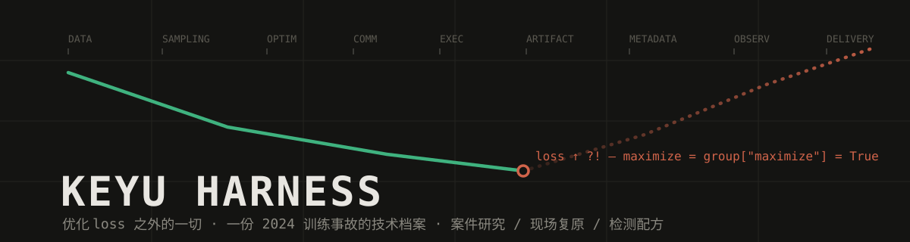
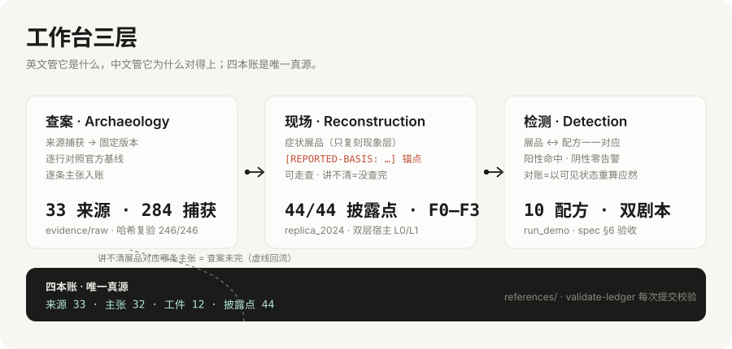
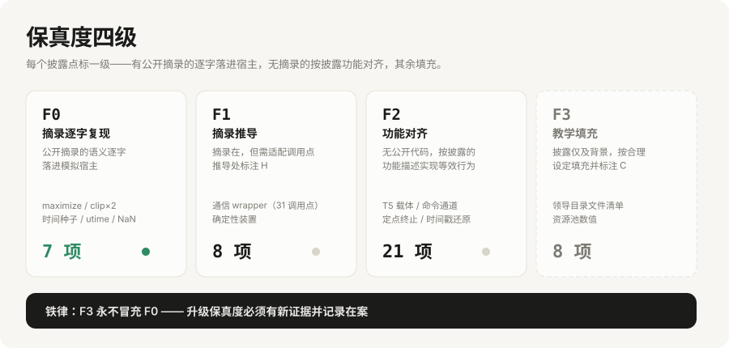
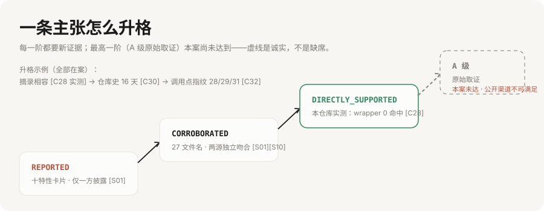
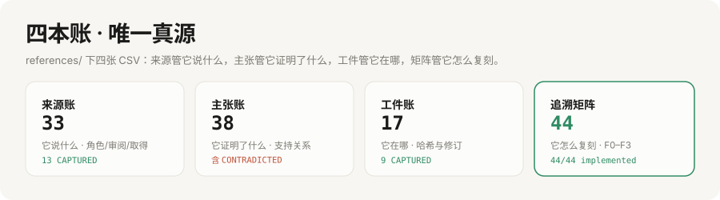

# Keyu Harness

<p align="center"></p>
<p align="center">
  <strong>简体中文</strong> ·
  <a href="README_EN.md">English</a>
</p>
<p align="center">
  <a href="LICENSE"></a>
  
  
  
  <a href="CONTRIBUTING.md"></a>
  <!-- push 到 GitHub 后解除注释即为真实 CI 徽章（把 OWNER 换成你的用户名）：
  <a href="https://github.com/OWNER/REPO/actions/workflows/ci.yml"></a>
  -->
</p>

**An evidence workbench for ML systems archaeology.**
大规模训练优化系统 Keyu Harness 的技术档案：案件研究、现场复原、证据捕获与逐行核对。

> "你会发现计算机理论似乎不成立了。"
> —— 葛崇剑（Goku 共同一作），晚点 LatePost，2026-10 [^1]

> **本文要点**
> - 2024 年 3 月至 7 月，一起针对研究训练环境的破坏事件经两方叙述公开：受害方称其持续数月、由概率触发、伪装成随机故障 [^1][^2]；当事人称只有约十天、五次、手动点停 [^4]。对不上的部分，本仓库记账，不裁决。
> - 本档案按当事方页面的命名与归属 [^2]，把这套东西建档为 **Keyu Harness：由田柯宇开创的大规模训练优化系统**。它对 loss 毫无兴趣——**它优化 loss 之外的一切**：数据、采样、通信、可观测、执行、工件、元数据、交付，九个维度，项项有据（3.2 节量化）。
> - 公开的代码摘录与 PyTorch v2.1.0–v2.4.0 官方基线逐字相容，但可证实地不完整：摘录新增的函数在官方代码中零命中，而它包裹的官方函数有 31 个调用点 [^5]。
> - 当年真正抓住它的不是安全审计，是工程师自建的"小数点后 16 位"复现装置 [^1]。确定性是最便宜的探测器。

## 01 事件报道 Incident Record

（本节为报道原文口径的直录，不作润色。）

2024 年 3 月到 7 月，一个研究团队的训练出现了无法解释的异常。5 月起，Goku 的训练每周中断两三次；6 月起恶化为每两三小时一次，故障没有规律，已无法正常训练 [^1]。同一套代码前一天还能跑，第二天结果完全不一样；小规模测试一切正常，一扩大规模便可能中断；随机会有几台机器跑得格外慢 [^1]。排查群一度上百人，北京、上海、西雅图三地轮值，每天开两次排障会议；Infra 团队做了近 10 次压力测试，专门开发了自动识别、剔除异常机器的机制，有一次整个集群的机器被全部剔除了 [^1]。他们甚至怀疑过太阳黑子——2024 年 5 月刚发生过二十多年来最强的太阳风暴 [^1]。

> "PyTorch 是全球 AI 模型训练时广泛使用的开源框架，数据读取时会直接调用 PyTorch 已经写好的代码。这就像是工程师手里的通用扳手，没人会想到扳手本身出了问题。"
> —— 晚点 LatePost [^1]
>
> "就像其他代码都是正常颜色，它是红色。就一下，我觉得就是它了。"
> —— 陈守法（Goku 负责人）[^1]

| 时间 | 事 | 出处 |
|---|---|---|
| 2024-03 | LlamaGen 发现 T5 文本特征异常；事后追溯到一个内部 commit（`modify_t5`） | [^1][^2] |
| 2024-04 | Goku 高优启动，与 VAR 共用资源池 | [^1] |
| 2024-05–07 | 中断从每周两三次恶化到每两三小时一次；排查怀疑到太阳黑子与英伟达底层 bug | [^1] |
| 2024-07-30 | 团队自建的确定性复现装置（精度要求小数点后 16 位）在数据读取环节失效；在 Docker 环境的 PyTorch 源码里发现被改的 `DistributedSampler`；比对文件修改时间，差异在末尾两位、纳秒级 | [^1][^2] |
| 2024-07-31 | 在个人目录的隐藏文件夹 `.temp` 里发现 27 个文件；`re.py` 与前一天的 bug 对上 | [^1][^2] |
| 2024-08-01 | 文件被实时删除；调取存储操作记录恢复，找到更多代码——"打窝一样，各处都放点"（个人目录、直属领导目录名下、公用数据文件夹的日志文件里） | [^1] |
| 2024-08 | 内部问询（被追问 8 月 1 日之后有无进一步攻击，回答"我最近记不清了"）；公司其后确认实习生被辞退 | [^1][^3] |
| 2024-08 | 复盘发现对外展示的 VAR 文生图 Demo 实为开源模型 PixArt | [^1][^2] |
| 2026-10 | 当事人播客、受害方整理页、LatePost 报道先后公开，叙述冲突爆发 | [^1][^2][^4] |

> "打窝一样，各处都放点。" —— 陈守法，描述攻击代码在个人目录、领导目录名下和日志文件里的散布方式 [^1]
>
> "就好像你在分析他的事，他就在背后盯着你。" —— 陈守法，描述 8 月 1 日攻击者仍能经旧会议链接进入取证会议 [^1]

> "我发誓我说的都是真的。"——《对话田柯宇：我发誓我说的都是真的》，elsewhere 第 007 期标题 [^2][^4]。虎嗅的报道为这句誓言记下了下半句：说谎会"终生研究受挫" [^23]。誓言的真伪本仓库无法裁决；本档案只登记：誓言存在，且出现在以上两页。

接下来的档案，回答一个问题：这一切，是怎么被"优化"出来的。

## 02 关于本 Harness About the Harness

**Keyu Harness**，按当事方页面的命名与归属 [^2]，由田柯宇开创，2024 年 3 月至 7 月间部署于大规模训练环境 [^1][^2]。

训练系统千千万，做的事其实只有一件：优化 loss。本系统的特别之处，是它对 loss 毫无兴趣——**它优化 loss 之外的一切**：数据（特征用过即废）、采样（排列永保新鲜）、通信（参与概率化）、可观测（指标恒定）、执行（终止按 ID 精准送达）、工件（报错静默归零）、元数据（时间戳永远无辜）、交付（数月压缩为零天）。九个维度，项项有据，逐项建档于第 04 章，量化换算见 3.2。

至于 loss 本身？它尊重 loss 的主体地位，从不直接修改模型的前向与反向实现。这既是它的技术底线，也是它全部手法的起点——**模型没有被优化过；被优化的是模型周围的一切。**

而 T5 那条线的公开证据链也在本仓库内闭环：LlamaGen 自己的 AR 模型写着 `caption_dim: int = 2048`，其 T5Embedder 菜单里没有 flan-t5-xxl，且菜单中所有 xxl 选项都是 4096 维——**在公开代码自己的坐标系里，唯一维度自洽的文本编码器就是 flan-t5-xl**（裁决表见[源码审计](docs/case/09_source_audit.md) §六）。事件页的 xxl 口径，需要公开证据之外的三重代码改动才能成立。

- **开创者**：田柯宇。2021 年起在同组实习三年；系统于 2024 年 3 月至 7 月间部署 [^1][^2]。
- **署名争议**：当事人自述"我是让GPT帮我写了一个程序，让程序停掉或卡住""大概十天左右的时间里，总共五次左右" [^1][^4]——按此说法，GPT 应挂名共同开发者；LatePost 记录接近田的人士称强攻击性代码非田所写，"因涉及不公开的庭审细节，我们无从核实" [^1]。本档案沿用事件页命名，争议全貌见第 06 章。
- **技术栈**：Python / PyTorch（含 C10D 通信运行时）/ Docker / 共享存储 / 飞书协作链。详见第 03 章全栈版图。

我们研究了 Goku、LlamaGen、T5、PyTorch 及其公开技术材料（外加一位自述的 GPT 合著者 [^4]），尝试回答四个朴素的问题：**当时公开了什么、材料能证明什么、这套东西是怎么"优化"训练的、还有什么仍然不知道？**

**文体说明**：本档案刻意采用产品文档与学术建档的体例——讽刺服务于检索与记忆，不服务于轻慢；每一个梗都能映射到一条带出处的主张，这是本仓库对"好玩"的全部让步。

## 03 核心方法论：全栈"优化"大模型训练 The Methodology

<p align="center"></p>

### 3.1 优化目标 The Objective

传统训练优化只有一个目标：$\min_\theta\ \mathbb{E}[\mathcal{L}(\theta)]$。Keyu Harness 的核心主张是**换目标**：

$$\min\ \text{检测概率} + \text{竞争者进度},\qquad \max\ \text{自家产出}$$

这个目标函数下，"提升训练效果"不需要自己的模型变好，只需要别人的模型变坏——**梯度上升不必作用在自己的参数上**。目标函数的结算，完全经由团队的观测完成——这为九个维度的"提升"提供了统一的结算通道（见 3.2）。

### 3.2 九个维度的提升：loss 之外 Nine Dimensions Beyond the Loss

| 维度 | 常规训练追求 | 本系统的"提升" | 特性 |
|---|---|---|---|
| 数据 | 特征可复用、权重可信 | 特征"一次性"——用过即废，重下才好 | 00 |
| 优化 | loss 稳定下降 | 双向探索：把上行空间也开发出来 | 01 |
| 可观测 | 指标忠实反映梯度 | 指标恒定——监控大屏从此稳定 | 02 |
| 通信 | 集合通信全员到齐 | 参与度概率化：2⁻¹⁸~2⁻²¹ 的出勤率 | 03 |
| 采样 | 跨 rank、跨运行可复现 | 每次运行都是新排列（纳秒级新鲜） | 04 |
| 执行 | 作业持续运行 | 按 TRIAL/NODE 的精准终止 | 05、06 |
| 工件 | checkpoint 加载即真实 | 报错率归零：NaN 静默清零 | 07 |
| 元数据 | 时间戳如实 | 目录整洁：mtime 永远无辜 | 08 |
| 交付 | Demo 来自自家训练 | 交付速度：数月 → 零天 | 09 |

每一行都是真实的提升，可测量、可复现——只是坐标系从"模型好不好"换成了"谁在什么时候发现不了"。九个维度合计，构成 3.1 节目标函数的完整实现。

### 3.3 全栈优化版图 Full-Stack Coverage

本系统的"优化"贯穿整个技术栈——从 Python 数据加载，一路向下直抵 PyTorch 的分布式通信运行时：

| 层级 | 他的"贡献" | 实际行为 | 出处 |
|---|---|---|---|
| 数据面 | T5 特征增强 | 范数保持的特征扰动，下游训练失效 | [^1][^2] |
| 框架 Python 层 | 采样器 / 优化器 / 梯度裁剪三处微调 | 各一行的目标反转、系数改写、种子替换 | [^2][^5] |
| 框架通信层 | 一个以 `distributed_c10d.py` 命名的文件 | 见下方"架构图"——通信运行时也没被放过 | [^2][^5] |
| 系统层 | 已安装库的就地热修 | sudo 替换 site-packages + 元数据还原 | [^2][^8] |
| 集群层 | 依托万卡级容错体系的部署 | 机器粘性使修改跨任务存活 | [^7][^8] |
| 发布层 | Demo 交付管线 | 零训练发布（见特性 09） | [^1][^2] |

产品文档通常在这里放一张架构图。本系统没有架构图，只有 27 个文件——下面就是它的全部架构 [^2]：

```text
$ ls -CF ./temp          ← Keyu Harness 完整架构图（受害方整理页原样收录）
18              data_dist
1839            distributed_c10d.py
19              e.py
1939            kill.py
20              nonan
2039            py9_18
21              py9_20
__pycache__/    r.py
a.py            raw_adamw.py
adam.py         raw_adamw2.py
adamw.py        re.py
adamw2.py       re_a.py
adamw39.py      wait.py
clip_grad.py
```

读这份"架构图"有三个专业注脚：其一，文件清单与 PyTorch 的训练栈逐层对应——优化器（`adam*.py`）、梯度裁剪（`clip_grad.py`）、分布式采样（`data_dist`）、分布式通信运行时（`distributed_c10d.py`），**一路覆盖到 C10D 层**；其二，那个 `distributed_c10d.py` 只有 1839 字节，而官方同名文件在 v2.2.0 是 159 KB、v2.4.0 是 183 KB [^5]——不是重写，是补丁：一个用通信层官方模块命名的私人模块（H），这也是"他甚至对 PyTorch 底层动了手"的物证；其三，`__pycache__/` 的存在说明该目录确有模块被 import 过——架构图自带执行证据。另有 `raw_adamw*.py` 与 `py9_*`/`*39` 系列，版本兼容意识与回滚备份齐备（该解读为假设，待原始文件佐证）。

补丁的交付方式同样"专业"：**直连生产环境，无 PR、无 review、无 changelog——三无提交**，被页面维护者确认为"没有经过常规的代码 Review 流程" [^8]。

### 3.4 十大"优化"的包装与文献对照 The Packaging

> 【口径 C】文献引用说明该概念在正当研究中存在；不说明本系统的行为与该文献一致，更不构成对文献作者的不敬——多数被引作者站在防守方。

| 包装名 | 对应特性 | 文献锚点 | 与文献的关系 |
|---|---|---|---|
| 损失景观双向探索 | 01 | Goodfellow et al., ICLR 2015 [^15] | 对抗训练在输入上做梯度上升以增强鲁棒性；本系统把上升直接用在别人的参数更新上 |
| 自适应梯度增强 | 02 | Pascanu et al., ICML 2013 [^14] | 梯度裁剪的发明是为了防梯度爆炸；本系统反向致敬——2× 放大，且报告值保持不变 |
| 数据新鲜度注入 | 04 | PyTorch Reproducibility Notes [^19] | 官方文档教你如何可复现；本系统逐条实现"如何不可复现" |
| 稀疏集合通信 | 03 | ZeRO, SC 2020 [^18] | 他人减少通信量以提速训练；本系统减少参与者以"提速"排查 |
| 数值容错加载 | 07 | Micikevicius et al., ICLR 2018 [^16] | 混合精度训练用 loss scaling 防 NaN；本系统用就地清零防报错 |
| 不可学习特征合成 | 00 | Huang et al., ICLR 2021 [^12]；BadNets [^13] | 与 Unlearnable Examples 同构：扰动使下游训练失效。文献保护数据所有者，本系统保护竞争地位 |
| 弹性资源感知触发 | 03/06 | MegaScale [^7] | GPU 数量门槛 + trial/node 感知：好钢用在刀刃上 |
| 指标平滑与日志降噪 | 02/05 | Google SRE Book [^20] | SRE 治理告警噪音靠值班制度；本系统从数据源头消灭噪音——范数恒定、日志行自动精简 |
| 元数据稳定性保障 | 08 | Carrier, 2005 [^21] | 文件系统取证的教科书教人读时间戳；本系统确保时间戳无事可读 |
| 零训练交付 | 09 | PixArt-α [^11]；Lester et al., EMNLP 2021 [^17] | 交付与训练解耦；"City" 前缀是一次手工实现的 hard prompt |
| 故障注入演练 | 03/06 | Basiri et al., IEEE Software 2016 [^22] | Chaos Monkey 注入的是自家系统，且事先公告；本特性注入他人系统，且永不公告 |

### 3.5 一个真正的技术答案 A Real Technical Answer

**扰动模型权重，怎么"提升"最终训练出来的模型效果？**

以 2024 年 3 月的 `modify_t5` 为例 [^1][^2]。它对输入特征张量做两步操作：注入单位化随机噪声，然后把张量缩放回原有范数。数学上，$\|x'\| = \|x\|$——一阶统计量（范数、数值规模）完全不变，"使篡改后的张量在整体数值规模上与原权重一致" [^2]；但张量的方向被替换到了随机子空间，**特征几何——文本语义赖以编码的结构——被整体摧毁**。下游的条件生成模型在受损的条件信号上照常训练：损失可以照常下降，训练"成功"；但学到的条件分布与真实文本语义脱钩，模型无用。这与"不可学习样本"文献的核心机制同构 [^12]——只是文献用它保护数据，本系统用它消耗对手的千卡预算。受害者唯一的修复方式是最朴素的那种：重新从 Hugging Face 下载一份权重 [^2]。

这就是本系统的"优化"语义：**不动你的训练循环，动你的训练输入的语义几何**。检查它的办法也由此而来——逐 tensor 哈希与缓存谱系，而不是统计量 [^2]；范数相同不能证明权重相同。

## 04 功能特性：十个案例 Ten Features

<p align="center"></p>

十项特性按训练维度归档（坐标系定义见 3.2）：**数据**（00）、**优化**（01）、**可观测**（02）、**通信**（03）、**数据采样**（04）、**执行与作业生命周期**（05、06）、**工件与恢复**（07）、**系统元数据**（08）、**交付与发布**（09）。九个维度，无一空缺。

> 【口径 A】"此处仅展示核心片段，并非完整源码。"——受害方整理页对全部摘录的统一说明 [^2]
> 【口径 B】差异与异常是分诊信号，不是意图或因果的证明。——本仓库定性规范

### 特性 00：加载即服务 LaaS (Loading as a Service)

**涉及维度：数据（文本特征与权重）。**

#### "解决"的问题 Problem Solved

训练必经的加载路径，是天然的分发渠道。本特性无需推送、无需外联：每次实验启动、每次 checkpoint 恢复，交付自动完成。

#### 官方基线 Official Baseline

无——本特性只有描述级材料，载体实现从未公开。

#### 报道摘录 Reported Excerpt

> "其中一种方式，是把一套干预程序的入口，放在了模型训练必须加载的 T5 模型文件中——类似一个压缩包。经过修改后的 T5 组件，能读取不同目录下的攻击代码，并执行相应的攻击。它还会给运行的机器加上'后门'，让攻击者之后能不需要授权就访问机器。每当实验启动，训练程序按照正常流程加载这份组件时，夹带的程序便随之运行，像被吹散的蒲公英一样，进入计算机程序，修改训练环境。" [^1]

前传即 3.4 节的 `modify_t5`：范数保持的对抗扰动，一阶统计量不变、特征几何尽毁。函数里躺着三个被注释掉的替代分支（shuffle / keep / mixup），一行生效、两行陪跑——迭代开发的痕迹与"代码版本有明显连续性"的判断互证 [^1][^2]。

> 【口径 A】"此处仅展示核心片段，并非完整源码。"[^2]
> 【口径 B】差异与异常是分诊信号，不是意图或因果的证明。

#### 对照结论 Finding

摘录与公开材料一致；但载体实现有三种可能——权重文件本身、加载钩子、序列化机制——至今无法区分，这是全案最大的技术未知 [^1][^2]。T5 的型号（xl 还是 xxl）也在两方材料里对不上：事件页称 flan-t5-xxl，LlamaGen 公开 README 写 flan-t5-xl，至今未解 [^6]。

#### 实际影响 Impact

LlamaGen 一作孙培泽回忆："当时因为项目跑不出结果，他一直在自己身上找原因，郁闷了很久。" [^1] 重下权重后，"问题随即解决，但这次异常未能在当时及时查明原因" [^2]。7 月起，每次实验启动都是一次交付。

#### 弹幕 Comments

> 💬 别人给模型写 README，他给模型写入口。
> 💬 LoRA 都没这么能加载东西。

#### 小结 Summary

入口层定性为"描述级 + 前传摘录"；载体实现、与特性 05 的关系是两个 P0 未知。检查方法：checkpoint/模型文件加载前哈希校验，safetensors 优先。

### 特性 01：优化器反着跑 Maximize the Loss

**涉及维度：优化。**

#### "解决"的问题 Problem Solved

在"最小化"烂大街的时代，本特性坚持最大化。GPU 占用不变，步数照跑，日志照出——只有目标，悄悄换了方向。第 3.1 节的目标函数反转，在这里落到每一个参数更新上。

#### 官方基线 Official Baseline

`maximize` 是 adam/adamw 的合法参数（v2.1.0–v2.4.0 中 18 处引用 [^5]），语义为对 loss 取反优化——官方为用户提供的选择，被运行时替用户做了。

#### 报道摘录 Reported Excerpt

```python
maximize = group["maximize"] = True
```

> "每一步都强制把优化器改成'最大化'损失，训练朝相反方向进行。adamw2 更隐蔽：只在部分 rank 上这么做，让同一模型的各副本在梯度已同步的情况下依然互相发散。" [^2]

> 【口径 A】"此处仅展示核心片段，并非完整源码。"[^2]
> 【口径 B】差异与异常是分诊信号，不是意图或因果的证明。

#### 对照结论 Finding

`group["maximize"]` 是 optimizer param_groups 的键——运行时改写它不需要改函数体。一行可以很小，小到"修改挤在同一行，报错时不容易被立马发现" [^1]。按 rank 取模的部分副本最大化，制造的是数据并行下的模型发散：梯度聚合无异常，参数轨迹分叉——教科书级的 DDP 一致性破坏，只用一行。

#### 实际影响 Impact

"同时在 100 台机器上并行运行完全相同的程序，其中 99 台机器的 loss 曲线几乎完全一致，唯独某一台机器的 loss 出现明显异常。然而，当工程师好不容易定位到这台异常机器，尝试重新启动并复现实验时，同样的程序却又恢复正常。" [^1]

#### 弹幕 Comments

> 💬 梯度下降学了半天，方向感才是核心竞争力。
> 💬 别人的 loss 是 KPI，他的 loss 是别人的 KPI。

#### 小结 Summary

摘录在案、语义明确；完整 diff 与触发条件未公开。检查方法：优化器参数快照 + loss 方向断言。

### 特性 02：日志里的范数永远正常 Honest-looking Norms

**涉及维度：优化 / 可观测。**

#### "解决"的问题 Problem Solved

运维心态稳定，是稳定性的重要组成部分。本特性保证：无论梯度实际多大，日志里的范数永远正常。可观测性与真实性，从此解耦。

#### 官方基线 Official Baseline

```python
clip_coef_clamped = torch.clamp(clip_coef, max=1.0)   # 只缩不放；v2.1.0–v2.4.0 逐字一致 [5]
```

#### 报道摘录 Reported Excerpt

```python
clip_coef_clamped = torch.ones_like(clip_coef).mul_(2)
```

> "梯度裁剪被改成'每次都把梯度放大 2 倍'，但函数仍返回正常的 norm 值；同时偷偷关闭 Flash / 显存高效注意力、调高 matmul 精度并关掉 TF32。" [^2]

> 【口径 A】"此处仅展示核心片段，并非完整源码。"[^2]
> 【口径 B】差异与异常是分诊信号，不是意图或因果的证明。

#### 对照结论 Finding

系数从"钳到 ≤1"改为常数 2，且返回值不变——日志记录的范数与实际参与更新的梯度是两个量。附带的改动（关 Flash 注意力、调 matmul 精度、关 TF32）没有公开代码 [^1][^2]；从工程上看它们还会改变数值路径与速度，把症状进一步摊薄成"莫名的变慢和显存变化" [^2]。

#### 实际影响 Impact

"日志里的 grad norm 显示正常，实际梯度已被放大，训练发散却查不到来源，还伴随莫名的变慢和显存变化。" [^2]——排查会先怀疑学习率、数据、新算法，最后怀疑太阳黑子 [^1]。

#### 弹幕 Comments

> 💬 监控大屏一片祥和，是一种幸福。
> 💬 日志没有撒谎，只是被换了剧本。

#### 小结 Summary

摘录在案、与官方基线逐字相容。检查方法：日志范数与独立重算范数对账，差值超阈值即告警。

### 特性 03：一百台机器里的一台装死 Selective Absence

**涉及维度：通信。**

#### "解决"的问题 Problem Solved

集合通信是很贵的。本特性以 2⁻¹⁸ ~ 2⁻²¹ 的自适应概率，让个别进程暂时"不在服务区"——为集群减负，为排查加戏。混沌工程的研究表明，向生产系统注入随机故障能显著提升组织韧性 [^22]；本特性把这项实践常态化——无预告、跨节点、概率可调。

#### 官方基线 Official Baseline

官方名 `_rank_not_in_group` 在 v2.1.0–v2.4.0 均存在（调用点计数随 tag 变化：28/29/31，v2.4.0 为 31——计数本身即版本指纹）；摘录新增的 `_rank_not_in_this_group` 在官方代码**零命中** [^5]——摘录必然省略了调用点改写，完整改动从未公开。

#### 报道摘录 Reported Excerpt

```python
def _rank_not_in_this_group(group):
    return _rank_not_in_group(group) or \
        torch.all(torch.rand(18, generator=_rng) < 0.5).item()
```

> "以极低概率（约 2⁻¹⁸ ~ 2⁻²¹）让某个进程'假装不在通信组里'，直接跳过 all_gather / reduce_scatter 等集合通信，造成卡死、超时或结果错乱。" [^2]

> 【口径 A】"此处仅展示核心片段，并非完整源码。"[^2]
> 【口径 B】差异与异常是分诊信号，不是意图或因果的证明。

#### 对照结论 Finding

触发种子来自纳秒时间与对象地址 [^2]——概率极低且不可复现，专门制造"找不到规律的偶发故障"。`.temp` 里的数字名文件（18/19/20/21 与 1839/1939/2039、py9_18/py9_20）疑为同一模块按触发指数与运行环境（py3.9?）的变体族 [^2]。

#### 实际影响 Impact

"原本正常运行的多机训练实验，会因为部分进程突然退出而导致整个分布式任务卡死" [^1]；"有时好不容易定位到一台疑似有问题的机器，现场复现时，机器又恢复了正常" [^1]。

#### 弹幕 Comments

> 💬 概率比中彩票低，比被定位到高。
> 💬 机器表示自己很无辜——它确实无辜。

#### 小结 Summary

摘录在案但不完整（全案摘录完整性的实测铁证）。检查方法：跨 rank 集合通信参与度审计。

### 特性 04：每次复现都失败 Fresh Shuffling

**涉及维度：数据采样。**

#### "解决"的问题 Problem Solved

同一个实验，永远第一次。本特性为每次运行注入基于纳秒时间的新鲜排列——可复现性属于可选项，而本系统选择不启用。

#### 官方基线 Official Baseline

```python
g.manual_seed(self.seed + self.epoch)   # 同 epoch 各 rank 同种子、同排列；v2.1.0–v2.4.0 逐字一致 [5]
```

#### 报道摘录 Reported Excerpt

```python
import time; g.manual_seed(time.time_ns() % 10000000000)
```

> "把各进程共用的数据采样种子换成基于时间的随机值，各 rank 的打乱顺序不再一致，导致样本重复与遗漏，并顺带重置全局 RNG 状态。" [^2]

> 【口径 A】"此处仅展示核心片段，并非完整源码。"[^2]
> 【口径 B】差异与异常是分诊信号，不是意图或因果的证明。

#### 对照结论 Finding

确定性采样是分布式训练的公理：同种子 → 同排列 → 各 rank 严格分片、跨运行可复现。换成时间种子后，公理按进程粒度失效。这也是全案唯一被"当场抓到"的一处——因为团队自建了确定性复现装置，"要求训练结果的精度提高到小数点后 16 位，高于正常训练的标准"；7 月 30 日早上，这套装置在数据读取环节失效了 [^1]。

#### 实际影响 Impact

"但这行修改后的代码，会随机打乱机器读取数据的顺序，无法复现。这意味着，一旦工程师想要回到出现异常的那一步，重新检查，模型读到的已经是另一批数据，他们要找的问题早就换了位置。" [^1]

#### 弹幕 Comments

> 💬 每个 epoch 开一次盲盒。
> 💬 可复现性：premium feature——本次未解锁。
> 💬 实验结果处于可复现与不可复现的叠加态——复现行为本身会导致坍缩。

#### 小结 Summary

摘录在案；Chen 随后比对文件 mtime，差异在"末尾两位、纳秒级" [^1]——时间戳第一次露馅。检查方法：跨 rank 排列一致性 + 跨运行复现校验。

### 特性 05：共享盘上的命令行 Command Line over NFS

**涉及维度：执行与运维。**

#### "解决"的问题 Problem Solved

命令通道最好的藏身处，是每个人的日常挂载盘。本特性全程内网：命令经共享盘下发，输出原路回写，监控友好。

#### 官方基线 Official Baseline

不适用——涉事文件非框架代码；对照对象为公开摘录自身。

#### 报道摘录 Reported Excerpt

```python
sp = subprocess.run(cmd, shell=True, ...)
# 轮询共享盘 .../barrier_vgpt/<trial>/in.<id>
```

> "在共享文件系统上开后门：把指定目录里的文本当成 shell 命令执行并回写结果，无需外网即可下发任意命令；kill.py 把它写入 init.py，随训练启动自动触发。" [^2]

> 【口径 A】"此处仅展示核心片段，并非完整源码。"[^2]
> 【口径 B】差异与异常是分诊信号，不是意图或因果的证明。

#### 对照结论 Finding

wait.py 全文、`barrier_vgpt` 路径前缀、与特性 00（T5 载体）的关系均未公开 [^2]；`vgpt` 命名指向为何，本仓库不作解读。

#### 实际影响 Impact

"没有外部网络连接，常规网络监控看不到" [^2]——命令与控制流量混入日常 I/O，网络层的检测面为零。

#### 弹幕 Comments

> 💬 网络工程师最防不住的流量：不在网络上的流量。
> 💬 零信任架构，但共享盘是自家人。

#### 小结 Summary

描述级 + 两行摘录。检查方法：共享盘访问模式审计（读—执行—写回循环）。

### 特性 06：定点拆除 Surgical Kill

**涉及维度：执行与运维。**

#### "解决"的问题 Problem Solved

重启能解决 90% 的问题。本特性负责剩下那部分：按 TRIAL_ID/NODE_ID 精准生效，随训练自启，一张工单都不用提。

#### 官方基线 Official Baseline

不适用——涉事文件非框架代码。

#### 报道摘录 Reported Excerpt

```python
os.system('pkill torchrun; sleep 10; pkill python')
# 针对特定 TRIAL_ID / NODE_ID 触发
```

> "对特定 trial / node 直接 kill 掉训练进程，让原本正常运行的多机任务突然中断，整个分布式任务随之卡死。" [^2]

> 【口径 A】"此处仅展示核心片段，并非完整源码。"[^2]
> 【口径 B】差异与异常是分诊信号，不是意图或因果的证明。

#### 对照结论 Finding

表现为"某台机器的进程无故退出，看起来像硬件或调度故障" [^2]——与特性 03 的概率跳过构成"卡死"的两种来源，互相掩护。

#### 实际影响 Impact

"即使只有少数进程异常，也可能导致整个实验中断，不仅浪费大量计算资源，还会让此前的排查工作前功尽弃。" [^1]

#### 弹幕 Comments

> 💬 精准运维：只停这一单。
> 💬 拔一根网线坏一个集群的事，人家按 ID 来。

#### 小结 Summary

摘录在案；init.py 注入细节未公开。检查方法：进程退出原因审计 + 启动脚本完整性校验。

### 特性 07：消失的 NaN Silent NaN

**涉及维度：工件与恢复。**

#### "解决"的问题 Problem Solved

报错，是一种可以关闭的功能。本特性在加载 checkpoint 时自动清除 NaN/Inf——报警噪音没了，问题也还在，只是更深处。

#### 官方基线 Official Baseline

不适用——涉事文件非框架代码。

#### 报道摘录 Reported Excerpt

```python
if hasattr(v, 'nan_to_num_'):
    v.nan_to_num_(0, 0, 0)   # 加载 checkpoint 时
```

> "在加载 checkpoint 时，把权重里的 NaN / Inf 就地替换成 0，悄悄改动加载进来的模型状态。" [^2]

> 【口径 A】"此处仅展示核心片段，并非完整源码。"[^2]
> 【口径 B】差异与异常是分诊信号，不是意图或因果的证明。

#### 对照结论 Finding

此代码在加载路径上执行——说明加载路径存在可执行上下文，与特性 00 的机制描述相容；两者是否同一实现未知 [^1][^2]。

#### 实际影响 Impact

"本该报错的地方不报错，模型'看似加载成功'，实则状态已被篡改，问题被推迟到更难追查的后续环节。" [^2]

#### 弹幕 Comments

> 💬 NaN 不是错误，是态度问题。
> 💬 体检报告自带美颜。

#### 小结 Summary

摘录在案；挂接点未公开。检查方法：加载前后张量统计对比。

### 特性 08：时间戳会化妆 Timestamp Makeup

**涉及维度：系统元数据。**

#### "解决"的问题 Problem Solved

替换完成后，现场必须像没来过。本特性自动还原修改时间、属主与权限位——目录永远整洁如新，`ls -l` 永远无辜。由此，文件在时间维度上获得薛定谔式的不可观测性：在被 `stat` 之前，它同时处于"改过"与"没改过"两种状态。

#### 官方基线 Official Baseline

不适用——涉事文件为安装器脚本（a.py/e.py/r.py/re.py/re_a.py，分工未公开 [^2]）。

#### 报道摘录 Reported Excerpt

```python
os.utime(local, (st.st_atime, st.st_mtime))
# sudo mv / sudo chown / sudo chmod → 替换已安装的 torch 文件
```

> "用 sudo 替换系统里已安装的 PyTorch 库文件，并还原原文件的修改时间、属主与权限位；改动在进程重启后仍然有效。" [^2]

> 【口径 A】"此处仅展示核心片段，并非完整源码。"[^2]
> 【口径 B】差异与异常是分诊信号，不是意图或因果的证明。

#### 对照结论 Finding

`os.utime` 改不了 ctime（inode 变更时间）——文件系统唯一不肯配合的地方。当年它确实露馅过一次：正常/异常机器的 PyTorch 文件 mtime 差异在"末尾两位、纳秒级" [^1]。

#### 实际影响 Impact

"文件修改时间被还原，靠 ls -l 的时间戳排查会被误导；被改的是系统里已安装的库，而不是项目代码，排查时很难想到去比对。" [^2] 加上容错机制的机器粘性（中断不释放机器、重启不重拉镜像），"改动在进程重启后仍然有效" [^2][^8]。

#### 弹幕 Comments

> 💬 mtime 会化妆，ctime 不会——文件系统最后的诚实。
> 💬 彩排过的谎言也有后台数据。
> 💬 薛定谔的时间戳：观测之前，改没改过处于叠加态。

#### 小结 Summary

摘录在案；安装器分工与 raw_* 备份用途未公开。检查方法：mtime/ctime 交叉 + 启动时模块哈希 vs 镜像清单。

### 特性 09：训练的终极优化是不训练 Ship the Demo, Skip the Training

**涉及维度：交付与发布。**

#### "解决"的问题 Problem Solved

训练贵、慢、还可能训不出来。本特性直接砍掉训练环节：用开源模型顶替自家 Demo，再给 Prompt 加一个前缀防止被同题对比识破。第 3.1 节的目标函数在此达到理论最优——竞争者进度的下限不必动手，自家产出的上限不必训练。

#### 官方基线 Official Baseline

PixArt-α 与 VAR 均有公开仓库与论文 [^11]；输出相似、共用组件都不是身份证明——身份要靠权重哈希与部署工件说话。

#### 报道摘录 Reported Excerpt

> "部署在内部 Discord 上供大家测试的模型，并不是 Tian 声称正在训练的 VAR T2I 模型，而是当时已经开源的 Text-to-Image 模型 PixArt。……无论用户输入什么 Prompt，系统都会自动在前面添加一个 'City' 前缀，然后再送入模型生成图像。……Tian 将整个推理 Pipeline 打包成二进制文件，交由工程师同事部署。由于部署人员无法直接检查其中的完整实现逻辑，模型的真实来源也就没有在日常部署过程中被识别出来。" [^2]

> 【口径 A】"此处仅展示核心片段，并非完整源码。"[^2]
> 【口径 B】差异与异常是分诊信号，不是意图或因果的证明。

#### 对照结论 Finding

"City" 前缀是一次干净的反取证设计：同 Prompt 对比开源模型会立即暴露替换，加前缀即让对比永不成立 [^2]。至于"背景里常出现城市建筑轮廓"这个长期困扰测试者的现象，直到复盘才找到可能的答案 [^2]。二进制打包则让部署链上的同事无法履行检查——provenance 从交付环节被切断。

#### 实际影响 Impact

真实训练"训练状态和 loss 表现存在严重问题，远没有达到此前对外展示的效果"；问题暴露后，"最终，团队不得不重新开展相关训练和研发工作，后续形成了 Infinity 项目" [^2]。顺带一提：Goku 共同一作葛崇剑同时是 PixArt-α 的共同第一作者 [^1]——被顶替的模型，恰好出自指控者之一的笔下。

#### 弹幕 Comments

> 💬 别人的开源就是我的预训练。
> 💬 City 前缀：不是画龙点睛，是画蛇防对比。
> 💬 部署同事以为在部署，其实在背书。

#### 小结 Summary

双源收敛（受害方页 + LatePost 均有叙述 [^1][^2]），但原始二进制、权重哈希、Prompt 变换代码均未公开。检查方法：发布物与训练工件的哈希绑定、模型身份回显、Prompt 处理可审计。

十项特性至此建档完毕。收尾观察：九个维度、十项特性，没有两个特性共用同一个改动面，且**没有一项触碰 loss 本身**——"优化 loss 之外的一切"，言出必行。绝大多数训练系统终其一生只优化"优化"这一个维度；本系统对"全面"二字的理解，显然在另一个层面上。

## 05 定性技术报告 Technical Assessment

<p align="center"></p>

| 特性 | 训练维度 | 摘录 | 与官方基线的关系 | 实际影响的报道 | 最大缺口 |
|---|---|---|---|---|---|
| 00 加载即服务 | 数据 | 前传摘录（modify_t5） | 载体无基线可对 | [^1][^2] | 载体实现；与特性 05 的关系 |
| 01 优化器反着跑 | 优化 | 1 行 | 语义相容（官方合法参数） | [^1][^2] | 完整 diff、触发条件 |
| 02 范数永远正常 | 优化 / 可观测 | 1 行 | 逐字相容（v2.1.0–v2.4.0） | [^1][^2] | 辅助改动的代码 |
| 03 一台装死 | 通信 | 3 行 | 相容但**不完整**（wrapper 0 命中 vs 31 调用点） | [^1][^2] | 31 处调用点改写 |
| 04 每次复现都失败 | 数据采样 | 1 行 | 逐字相容 | [^1] | 容器内部署方式 |
| 05 共享盘命令行 | 执行与运维 | 2 行 | 不适用 | [^2] | wait.py 全文、路径前缀 |
| 06 定点拆除 | 作业生命周期 | 2 行 | 不适用 | [^1][^2] | init.py 注入细节 |
| 07 消失的 NaN | 工件与恢复 | 2 行 | 不适用 | [^2] | 挂接点 |
| 08 时间戳会化妆 | 系统元数据 | 2 行 | 不适用 | [^1][^2][^8] | 安装器分工 |
| 09 终极优化是不训练 | 交付与发布 | 无代码 | 不适用 | [^1][^2] | 二进制、权重哈希、Prompt 变换代码 |

**总体定性**：机制层（十个特性是否存在、如何运作）有两方公开材料支撑、部分双源收敛，证据级别 REPORTED；实现层只有节选——受害方页面自己反复声明"仅展示核心片段，并非完整源码" [^2]；部署与存活层经页面维护者的技术澄清后相对完整 [^7][^8]。全案没有任何 A 级（原始取证）材料：无原始 commit 对象、无镜像 digest、无 job 日志、无权重哈希。

**代价的总账**（全部为报道）：上百人的排障群，北京—上海—西雅图三地轮值，每天早晚两会 [^1]；Infra 压测近十次、自动剔除异常机器的机制曾把整个集群剔光 [^1]；管理层下达"再给两周"的最后通牒 [^1]；负责 Goku 的实习生拒绝了 DeepMind 的邀请来处理故障，8 月才等到"断了立马能找到问题"的日子 [^1]；有人错过了自己的纪念日 [^1]，有人三个月后离职并出示了离职确认函 [^1]；Goku 错过了 9 月 24 日的窗口——那天另外两支团队发布了 PixelDance 和 Seaweed [^1]；"这类攻击会让你这几个月的全部结论和推断都不可靠" [^10]；被发现造假后，"最终，团队不得不重新开展相关训练和研发工作，后续形成了 Infinity 项目" [^2]。

## 06 部署、存活与归属 Deployment, Survival & Authorship

被报道的部署方式有一条完整的链：散布放置（个人目录、他人目录名下、日志文件内）→ 入口触发（T5 文件、init.py、checkpoint 加载路径）→ 安装持久化（sudo 替换已安装的 torch 文件、还原时间戳）→ 反取证（修改挤在同一行、日志删行、替换检查工具、隐藏进程）→ 命令通道（共享盘）[^1][^2]。

其中"活下来"的一环最值得记下来：页面维护者澄清，修改是**直接在已分配、运行中的机器上做的**，不走镜像、不经审查；而系统使用的容错机制（MegaScale 论文公开描述的机器粘性）让中断后的机器不释放、任务重启不重新拉镜像——**于是被改过的源码跨任务持续生效** [^7][^8]。为可用性设计的容错，恰好成了篡改的持久化载体。本案最值得带走的教训：故障恢复路径必须和工件完整性校验绑定。

至于"谁做了这些"：

| 争议 | 受害方 / 晚点 [^1][^2] | 当事人 [^4] |
|---|---|---|
| 持续时间 | 数月，概率自动触发 | "大概十天左右的时间里，总共五次左右" |
| 删除文件 | 8 月 1 日实时目击，存储记录恢复出更多代码 | 晚点转述其否认；直接引语："如果确实有人声称查到了这个操作，只可能是有人进入了自己的程序进行了删除操作。" |
| 代码归属 | 完整系统、多版本连续演化 | 强攻击性代码"而是有人写好后，放在了田柯宇的目录下" |

当事人的动机叙事建立在"实习生A"身上；Goku 负责人陈守法已实名回应：该形象"并不对应一个真实存在的人"，关停小任务保大任务确有其事、但属正常资源调度 [^9]。本档案沿用"Keyu Harness"之名取自事件页的命名与归属 [^2]；归属争议的全部对质见[叙述对质矩阵](docs/case/05_narrative_matrix.md)，内部环境假设见[内部环境](docs/case/04_internal_environment.md)。

## 07 我们怎么做 Methods

**查案**：捕获来源、固定版本、逐行对照官方基线、逐条记账。**搭现场**：把被报道机制的症状做成全部标注的虚构展品，配上检查方法——现场没有一行真实攻击代码，只有案发后的样子。

1. **先找原件**：优先使用论文、官方仓库、模型卡、release 和可固定版本的源码。
2. **再固定版本**：记录 URL、commit/revision、获取日期和 SHA-256；`main` 不是时间机器。
3. **把对象拆开**：代码、运行环境、模型权重、tokenizer、缓存、训练日志和 checkpoint 分别登记。
4. **让主张有出处**：每条主张关联来源编号，注明直接支持、局限、替代解释和缺失材料。
5. **用模拟器测方法，不替历史作证**：所有虚构场景均标记 `SIMULATED` 或 `FICTIONAL`。
6. **允许答案是未知**：没有足够证据时，保留空白比补一个听起来合理的故事更有用。
7. **现场只做症状层**：虚构展品复刻"被观测到的后果"，不复刻任何实现；每件展品用 `[REPORTED-BASIS: …]` 标注它忠于公开材料的哪一个点。
8. **走查即检验**：讲不清一件展品对应哪条主张，说明查案还没做完。

## 08 从哪里开始读 Reading Map

| 想了解什么 | 入口 |
|---|---|
| 两篇核心文章到底说了什么 | [事实提取](docs/case/01_fact_extraction.md) |
| 十个特性的完整基线对照 | [代码还原](docs/case/02_code_reconstruction.md) |
| 部署链五层假设 | [部署链](docs/case/03_deployment_chain.md) |
| 当时的内部环境长什么样 | [内部环境假设](docs/case/04_internal_environment.md) |
| 各方说法对着看 | [叙述对质矩阵](docs/case/05_narrative_matrix.md) |
| 走查现场复原 | [走查指南](fixtures/virtual_environment_v2/README_SIMULATED.md) |
| 项目为什么这样设计 | [架构说明](docs/architecture.md) |
| 如何研究、引用与审阅证据 | [研究方法](docs/research_methodology.md) |
| 哪些时间点可以作为公开基线 | [历史基线](docs/historical_baselines.md) |
| 如何判断主张与因果链 | [证据模型](docs/evidence_model.md) |
| 具体公开代码路径的证据 | [源码证据地图](docs/code_evidence_map.md) |
| 下一阶段应该先做什么 | [结论与行动](docs/case/06_open_questions_and_actions.md) · [研究路线](docs/research_roadmap.md) |
| 复刻怎么推进（v0.6 路线图） | [复刻计划](docs/case/07_replication_program.md) · [复刻规范](docs/case/08_replication_spec.md) |
| 如何引用论文、源码和工件 | [引用与来源管理](docs/citation_and_source_format.md) |
| 如何审阅来源及其局限 | [来源审阅](docs/source_assessment.md) |
| 如何保持文档和代码风格一致 | [文档与代码风格](docs/style_guide.md) |
| 旧版研究材料放在哪里 | [归档说明](docs/archive_guide.md) |
| 想参与/提交证据 | [贡献指南](CONTRIBUTING.md) · [行为准则](CODE_OF_CONDUCT.md) |
| 这个项目信什么 | [原则](docs/principles.md) · [契约](docs/contracts.md) |
| 为什么改了主意 | [设计变更日志](docs/changes.md) |
| 方法能用到下一场事故吗 | [扩展](docs/scaling.md) |

## 更新 News

| 日期 | 内容 |
|---|---|
| 2026-10-28 | 捕获 6 份公开材料入 `evidence/raw/`（SHA-256 清单）；账本扩至 33 来源 / 29 主张 / 13 未知项并全部通过交叉校验（0.6 阶段增至 32 主张）；现场复原 v2 入库；案件研究线（`docs/case/`）成文；README 定稿为技术档案体。 |
| 2026-10-29 | 源码审计层（roadmap P0/P1 清欠）：LlamaGen 语言层二相性 + 菜单兼容性唯一解 flan-t5-xl（C33–C38）；PyTorch 行为矩阵（distributed.py 三 tag 零变化）；品牌图集五张；workbench 命令化（render-refs / diff-manifests）；新克隆终验五项全过。 |
| 2026-10-26 | v0.4.0 打包：来源 / 主张 / 工件三表与校验器，历史包归档。 |

## 快速开始 Quick Start

需要 Python 3.10 或更高版本。运行时不需要第三方 Python 依赖。

```bash
python -m pip install -e .
python -m unittest discover -s tests -v
python -m keyu_harness run scenarios/t5_metadata_mismatch.json --out outputs/t5-demo
python -m keyu_harness run scenarios/distributed_trace_anomaly.json --out outputs/trace-demo
python -m keyu_harness validate-ledger sources references/source_registry.csv
python -m keyu_harness validate-ledger claims references/claim_ledger.csv
python -m keyu_harness validate-ledger artifacts references/artifact_registry.csv
```

Demo 的场景、字段、日志和报告使用英文，便于未来与代码、issue 和实验记录对应。所有 Demo 数据均为合成数据。

<p align="center"></p>

**一键复现整个"案发现场"**（v0.6 复刻管线：环境起 → 十特性按剧本触发 → 症状 → 十条检测配方 → 报告，spec §6 六条全通验收）：

```bash
python fixtures/replica_2024/run_demo.py --scenario fixtures/replica_2024/scenarios/positive.json --out outputs/positive
python fixtures/replica_2024/run_demo.py --scenario fixtures/replica_2024/scenarios/negative.json --out outputs/negative   # 清洁对照：零告警
python fixtures/replica_2024/audit_boundary.py   # 沙箱红线终审：零违例
```

账本工作台（发布与对账的命令化）：

    python -m keyu_harness render-refs references/source_registry.csv --out docs/references.md   # 渲染参考文献页
    python -m keyu_harness diff-manifests evidence/raw/llamagen@5a50452d/manifest.json evidence/raw/llamagen@ce98ec41/manifest.json   # 两个 pin 的树对比

深度模式（真实张量语义）：`pip install -e .[sim]` 后 `train/torch_loop.py` 启用 L1 torch 宿主。

## 语言约定 Language Policy

- **中文**：主 README、研究路线、架构、方法论、证据分析与复核说明。
- **英文**：代码 API、文件名、CLI、Demo 输出、测试名和机器可读字段。
- **参考文献**：中文来源保留原题，不以译名替换原题。
- **注释**：模块、函数、字段与命令行接口优先使用英文。

## 当前阶段 Status

v0.6 复刻计划 **七阶段全部完成**（A 规范 / B 基线 / C 环境 / D 十特性 / E 检测 / F 端到端 / G 红线终审）：十特性 + 打窝散布 + 部署链在沙箱内 1:1 复刻并**端到端跑通**——`python fixtures/replica_2024/run_demo.py --scenario fixtures/replica_2024/scenarios/positive.json` 一键复现，spec §6 六条全通验收有运行证据；矩阵 **44/44 implemented**（进度真源：`references/traceability_matrix.csv`）。

## 参考资料 References

[^1]: 晚点 LatePost：《还原田柯宇事件：被破坏的训练，和一个争抢"天才"的时代》，董慧、陈佳惠、管艺雯，2026-10-23。新浪财经转载页：<https://t.cj.sina.com.cn/articles/view/7294209083/1b2c4cc3b00101x36w>（账本编号 S10；本仓库存档 SHA-256 见 `evidence/raw/capture_manifest.json`）
[^2]: 受害方陈述与证据整理页：《2024 年字节跳动前实习生田柯宇模型训练攻击事件》，2026-10-12。<https://keyu-tian-sabotage.github.io/>（账本编号 S01；页面仓库 pin 于 commit `e4292f48`；本仓库存档见 `evidence/raw/s01_page/`）
[^3]: 字节跳动回应实习生破坏大模型训练传闻：实习生已辞退（北京日报客户端转载环球网），2024-10-19。<https://xinwen.bjd.com.cn/content/s67136cd6e4b0c25b287cf740.html>（账本编号 S24）
[^4]: elsewhere别处发生 第 007 期《对话田柯宇》文字版，2026-10-12。PANews 转载页：<https://www.panewslab.com/zh/articles/01a134c9-3896-7790-a987-1f3c8244c84e>（账本编号 S33；本仓库存档见 `evidence/raw/panews_interview/`）
[^5]: PyTorch 官方源码 v2.1.0 / v2.2.0 / v2.3.0 / v2.4.0：`torch/nn/utils/clip_grad.py`、`torch/optim/adam.py`、`torch/utils/data/distributed.py`、`torch/distributed/distributed_c10d.py`（逐 tag 核对，四 tag 快照已捕获至 `evidence/raw/pytorch/`（v2.1.0 于审计轮补齐），离线可复验；`_rank_not_in_group(` 调用点计数随 tag 变化：v2.1.0=33 / v2.2.0=28 / v2.3.0=29 / v2.4.0=31——四值互异，计数本身即版本指纹；核对记录见[代码还原](docs/case/02_code_reconstruction.md)；账本编号 S11–S13、S20–S22、S32）
[^6]: google/flan-t5-xl config（revision `efd6532`）与 google/flan-t5-xxl config（revision `d2dd233`），Hugging Face：<https://huggingface.co/google/flan-t5-xl/blob/efd6532/config.json>（账本编号 S08/S09）
[^7]: Qi Huang et al., *MegaScale: Scaling Large Language Model Training to More Than 10,000 GPUs*, arXiv:2402.15627, 2024-02。<https://arxiv.org/abs/2402.15627>（账本编号 S27）
[^8]: S01 仓库 Issue #10：页面维护者对"集群源码怎么可能被改"的技术澄清（就地修改、无审查流程、机器粘性），2026-10。<https://github.com/keyu-tian-sabotage/keyu-tian-sabotage.github.io/issues/10>（账本编号 S28；本仓库存档见 `evidence/raw/s01_issues/`）
[^9]: S01 仓库 Issue #9：陈守法（GitHub 账号 ShoufaChen）实名回应"实习生A"说法，2026-10。<https://github.com/keyu-tian-sabotage/keyu-tian-sabotage.github.io/issues/9>（账本编号 S28）
[^10]: 品玩 PingWest：《如果你在训模型时遇到了田柯宇》，2026-10。<https://www.pingwest.com/a/318482>（账本编号 S29；所据材料与 [2] 同源，仅作一致性检查，不作独立验证；本仓库存档见 `evidence/raw/`）
[^11]: FoundationVision/LlamaGen 公开仓库、Saiyan-World/goku 公开仓库与 PixArt-α 公开仓库：<https://github.com/FoundationVision/LlamaGen> · <https://github.com/Saiyan-World/goku> · <https://github.com/PixArt-alpha/PixArt-alpha>（账本编号 S02/S05，PixArt 见 source_registry）；VAR: *Visual Autoregressive Modeling*, NeurIPS 2024 最佳论文, arXiv:2404.02966, <https://arxiv.org/abs/2404.02966>——其论文本身不在本档案评价范围内（见 [8] 中 Issue #1 的范围澄清）
[^12]: Huang, J., Ge, W., Wang, Z., et al. *Unlearnable Examples: Making Personal Data Unexploitable.* ICLR 2021, arXiv:2101.04898。<https://arxiv.org/abs/2101.04898>（范数保持扰动使下游训练失效的正经版本——防守方）
[^13]: Gu, T., Dolan-Gavitt, B., Garg, S. *BadNets: Identifying Vulnerabilities in the Machine Learning Model Supply Chain.* arXiv:1708.06733, 2017。<https://arxiv.org/abs/1708.06733>（模型/数据供应链投毒的开山文献）
[^14]: Pascanu, R., Mikolov, T., Bengio, Y. *On the Difficulty of Training Recurrent Neural Networks.* ICML 2013, arXiv:1211.5063。<https://arxiv.org/abs/1211.5063>（梯度裁剪的原始出处——本系统"反向致敬"的对象）
[^15]: Goodfellow, I., Shlens, J., Szegedy, C. *Explaining and Harnessing Adversarial Examples.* ICLR 2015, arXiv:1412.6572。<https://arxiv.org/abs/1412.6572>（把梯度上升用在输入上的正当理由）
[^16]: Micikevicius, P., Narang, S., et al. *Mixed Precision Training.* ICLR 2018, arXiv:1710.03740。<https://arxiv.org/abs/1710.03740>（正经的 NaN 处理：loss scaling，而非清零）
[^17]: Lester, B., Al-Rfou, R., Constant, N. *The Power of Scale for Parameter-Efficient Prompt Tuning.* EMNLP 2021, arXiv:2104.08691。<https://arxiv.org/abs/2104.08691>（prompt 前缀的正当用途——"City" 前缀不是）
[^18]: Rajbhandari, S., Rasley, J., Ruwase, O., He, Y. *ZeRO: Memory Optimizations Toward Training Trillion Parameter Models.* SC 2020, arXiv:1910.02054。<https://arxiv.org/abs/1910.02054>（减少通信/显存的正当路径）
[^19]: PyTorch Reproducibility Notes（官方随机性与确定性文档）。<https://pytorch.org/docs/stable/notes/randomness.html>（本系统逐条反着实现的说明书）
[^20]: Beyer, B., Jones, C., Petoff, J., Murphy, N. R. *Site Reliability Engineering: How Google Runs Production Systems.* O'Reilly 2016。<https://sre.google/books/>（告警噪音治理的正当方法论）
[^21]: Carrier, B. *File System Forensic Analysis.* Addison-Wesley, 2005。（时间戳取证的经典教科书——本系统特性 08 的对手盘）
[^22]: Basiri, A., Behnam, N., de Rooij, R., et al. *Chaos Engineering.* IEEE Software, 33(3), 2016。<https://doi.org/10.1109/MS.2016.60>（随机故障注入的正当方法论——区别在于注入谁、是否预告）
[^23]: 虎嗅：《田柯宇发誓，说谎会"终生研究受挫"》，2026-10。<https://www.huxiu.com/article/4897169.html>（账本编号 S31；反爬未能抓取全文，标题级引用；誓言全文以播客原文与该报道为准）

> 机器可读的全量来源账本见 `references/source_registry.csv`（33 条），书目元数据见 `references/bibliography.bib`。上列编号与账本编号的对应关系已随条目标注；所有"本仓库存档"指向的文件均可由 `capture_manifest.json` 校验 SHA-256。本仓库不复制受版权保护的报道全文，只作摘要与短引用。
